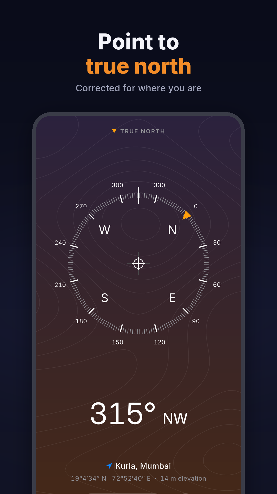
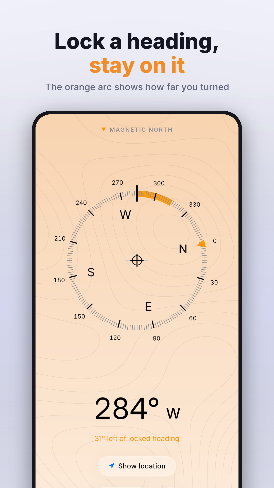
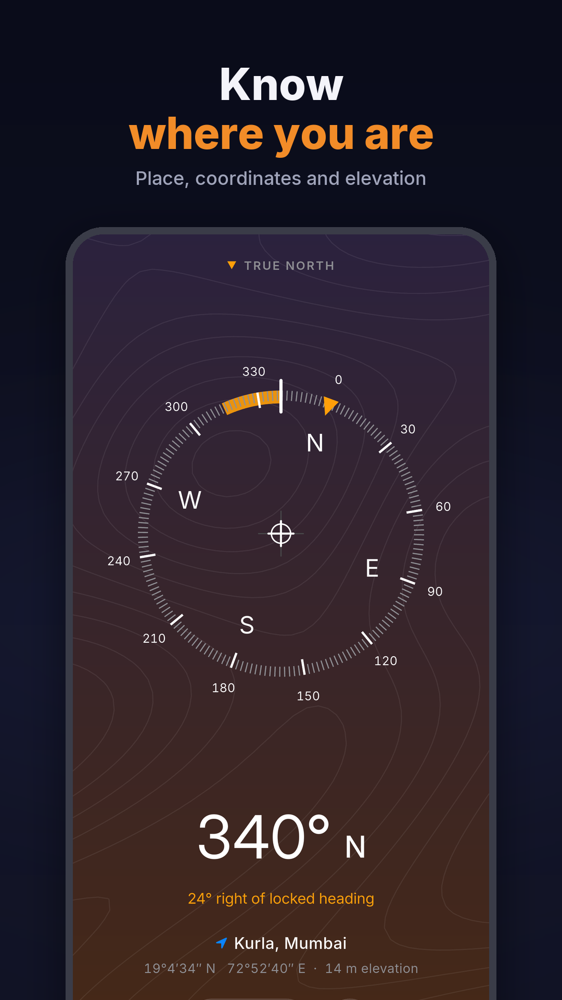
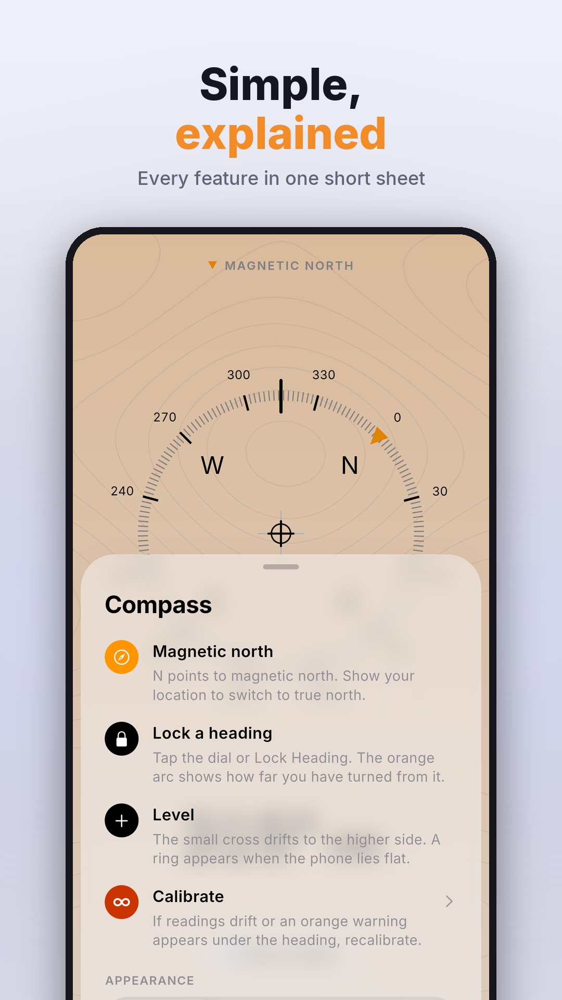
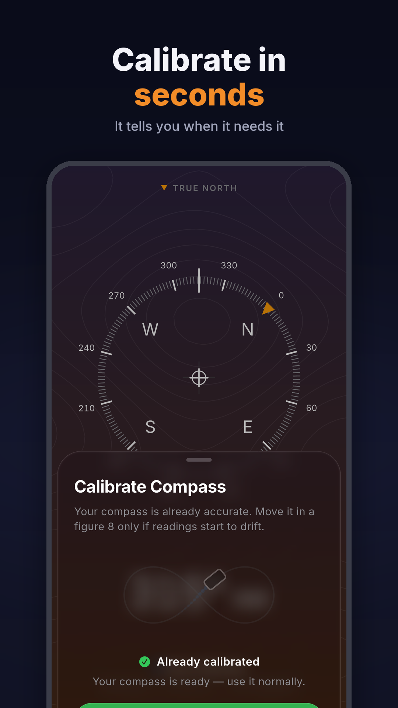
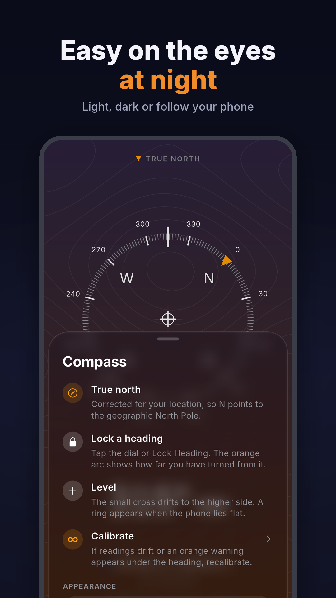
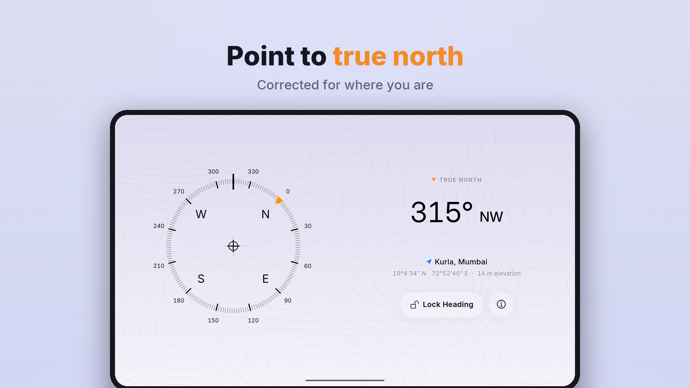
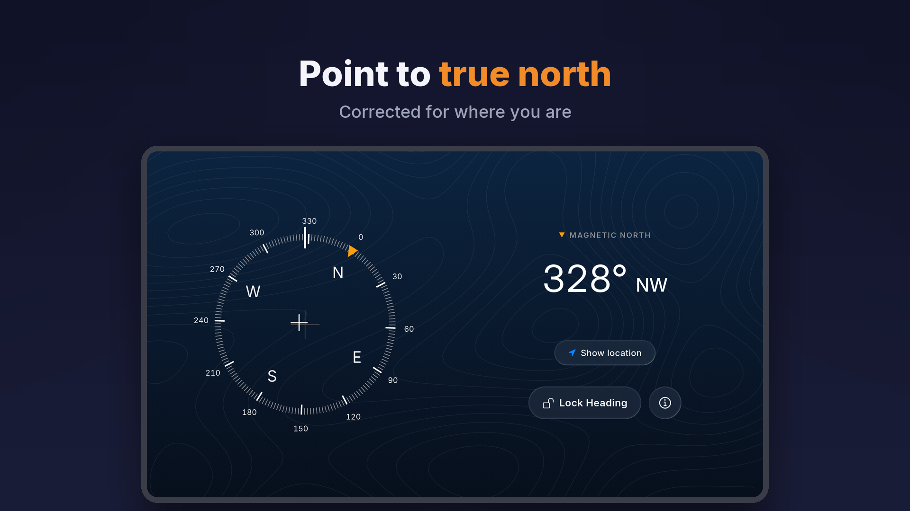

# Compass

A calm, accurate compass for Android: true north, a heading you can lock, a level, and where you are. No ads, no account.

<p>



</p>
<p>



</p>





## Download

Get the latest APK from [Releases](https://github.com/GagandeipSingh/compass/releases/latest). Most phones use the **arm64-v8a** file. Requires Android 7.0 or newer.

## Features

- **True north:** magnetic north by default; show your location and it corrects to true north
- **Lock a heading:** tap the dial or Lock Heading, and an orange arc shows how far you have turned
- **Where you are:** place name, coordinates and elevation
- **Level:** a small cross drifts to the higher side, and a ring appears when the phone lies flat
- **Calibrate:** a guided figure 8 when readings drift, and it tells you when it is already accurate
- **Light or dark:** or follow your phone
- **Any screen:** phones, tablets, foldables and desktop mode

## Build

```
flutter pub get
flutter run
```

Release builds read signing details from `android/key.properties`, which is not in this repo. Without it, release builds fall back to the debug key.

## Privacy

Location is used only after you tap Show location, to correct to true north and name the place. To find the place name, Android's built-in geocoder looks up your coordinates. Compass stores nothing and has no account. Settings stay on your device.
